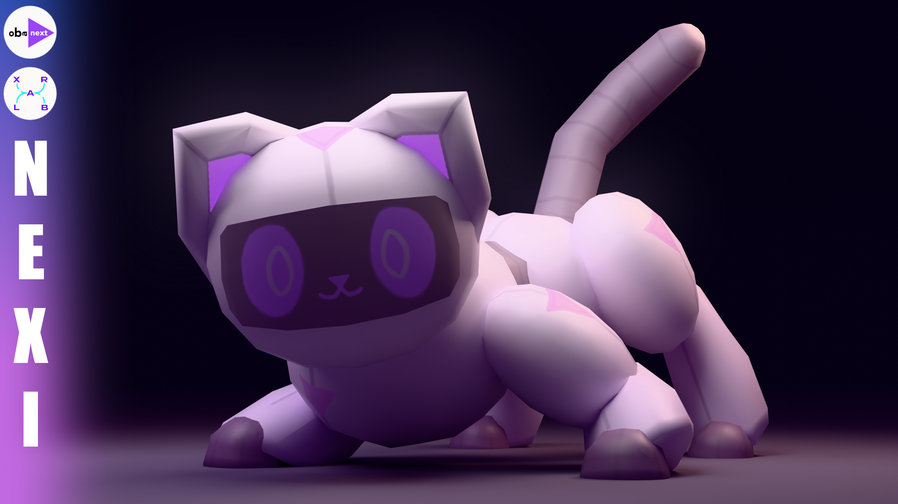
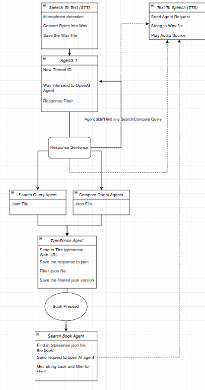
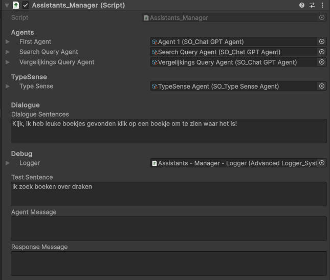
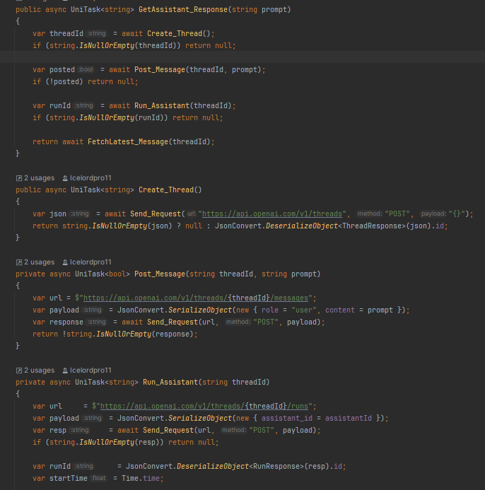
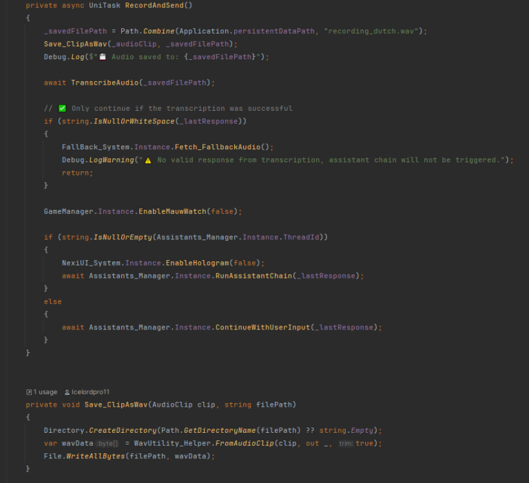
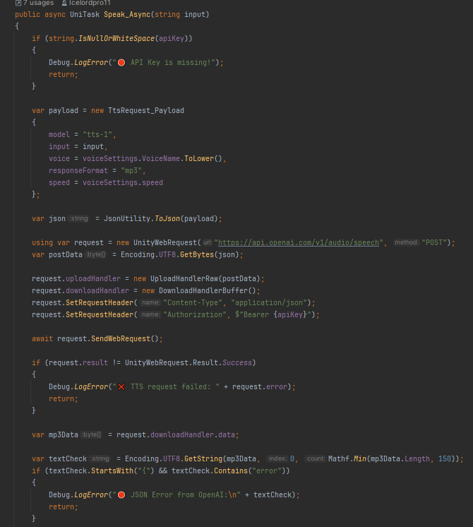
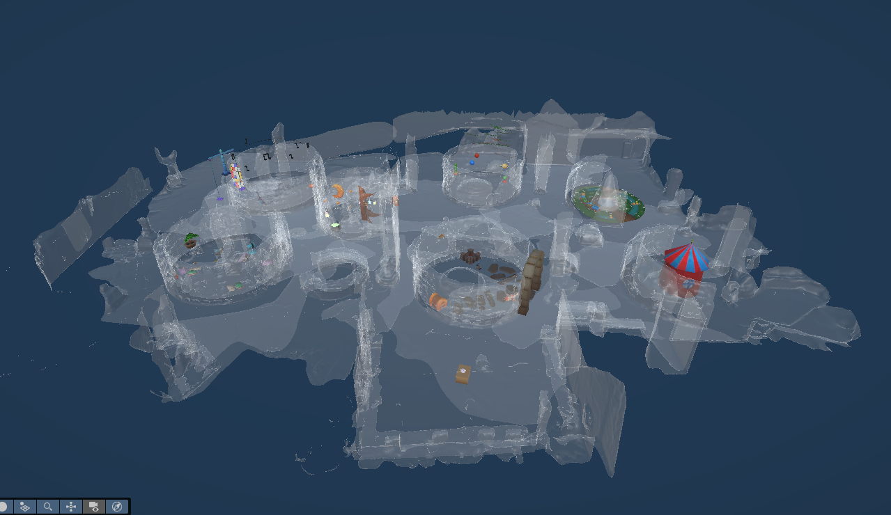
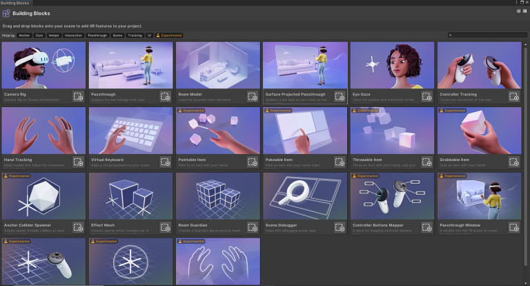

 

# OBA Next MR — Nexi AI Assistant

**An AI-powered mixed-reality library experience for children, built with Unity and Meta Quest 3.**

Nexi helps children explore the Amsterdam Public Library, ask questions naturally, and discover relevant books through voice interaction and specialized AI agents.

## Overview

Nexi combines a Unity mixed-reality experience with an AI conversational system. Voice input is transcribed into text, routed through specialized agents, and answered with generated speech. Spatial mapping helps place virtual content in the real library environment.

### Key Features

- **AI-powered conversations** using OpenAI services.
- **Voice interaction** with speech-to-text and text-to-speech.
- **Multi-agent workflow** for interpreting requests, searching, and comparing book information.
- **Mixed Reality** for Meta Quest 3, including passthrough and spatial anchors.
- **Spatial mapping** using a Polycam scan of the library.

### Technologies

`Unity` · `C#` · `Meta Quest 3` · `Mixed Reality` · `OpenAI API` · `Speech-to-Text` · `Text-to-Speech` · `Polycam`

## Code & System Architecture

The project combines a conversation manager, dedicated AI agents, and separate speech input and output components.

### AI Agents Flowchart

This diagram illustrates how the agents work together to process a request and return a response.

  

### Assistant Manager

The `Assistants_Manager` Unity singleton coordinates the multi-agent conversation. It sends user input to the primary agent, manages the conversation thread, and receives responses.

  

### OpenAI Agent

The `so_ChatGPTAgent` ScriptableObject connects Nexi to the OpenAI API. It manages conversation threads, sends prompts, checks response status, and returns assistant replies.

  

### Speech-to-Text System

The speech input component records microphone audio, saves it as a WAV file, sends it for transcription, and passes the recognized text into the conversation flow.

  

### Text-to-Speech System

The speech output component sends generated text to the OpenAI audio API, receives MP3 audio, and plays it in Unity. It can also trigger UI feedback and facial animations during playback.

  

## Mixed Reality & Spatial Mapping

### Pathfinding and Spatial Mapping

Polycam was used to scan the library floor and create a 3D representation of the environment. The scan was imported into Unity and used with spatial anchors to position virtual objects in the physical space. Passthrough blends virtual elements with the real environment.

  

### Meta XR SDK

  

## Other Project Media

Additional project media is available in the `Docs` folder:

- [Nexi media](Docs/Nexi-Media.mp4)
- [Nexi popup demonstration](Docs/Nexi-Popup.mp4)
- [Showcase AI](Docs/Showcase-AI.mp4)
- [Showcase testing](Docs/ShowcaseTesting.png)
- [Hand interaction](Docs/hand-interaction.mp4)
- [Meta XR SDK image](Docs/meta-xr-sdk.png)
- [OBA Next MR image](Docs/obanext.png)
- [OBA Next MR video](Docs/obanext.mp4)

---

  OBA Next MR · Unity · Mixed Reality · AI

